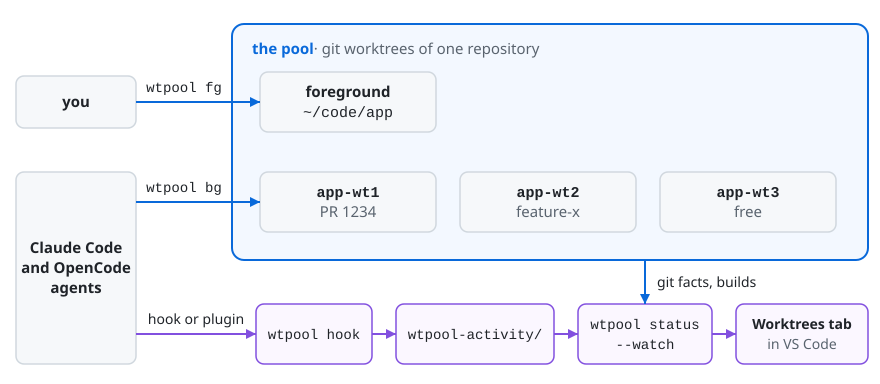

# wtpool

**Status:** version 0.2, alpha. Tested on macOS. Linux and Windows build but are untested.

wtpool gives you one git worktree to work in and a pool of reused worktrees for your coding
agents. A VS Code tab shows what each agent is doing. It works with any git repository on your
own machine.

<!-- hero -->
![Animation of the Worktrees tab in VS Code: agents start working in their worktrees, one waits for permission, a detail strip streams a background test's output, a worktree runs several agents, a worktree is freed through a confirm dialog, a Claude Code agent in the foreground starts an OpenCode agent with a DeepSeek model in the freed slot, a hover label on the agent's mark reads deepseek-v4.1-flash · OpenCode, its detail strip says it was launched by the Claude Code agent, and the machine button opens a strip with a running and a queued heavy job and the policy](docs/images/demo.gif)

- **One foreground, a few slots.** Your editor keeps one worktree. `wtpool bg` parks a branch or
  PR in a background slot for an agent, and `wtpool fg` brings a branch to you.
- **Warm builds.** Slots keep stable names and their build output, so a switch rebuilds only what
  changed.
- **Never loses work.** `wtpool` will not repoint, free or remove a worktree with uncommitted files
  or an operation in progress, or drop commits no ref holds. When git cannot tell, it refuses.
- **See every agent.** A Claude Code hook or an OpenCode plugin records what each session does. The
  Worktrees tab shows which worktree works, builds, waits for you, sits idle or is free, and marks
  each agent with its model's maker and its harness.
- **Heavy jobs take turns.** `wtpool job -- cargo test` runs a build or a test suite under one
  limit for every agent on the machine. The tab shows what runs, what waits and what runs outside
  the queue, and Claude Code and OpenCode can refuse a heavy command that skips it:
  [Heavy jobs](docs/heavy-jobs.md).
- **Agents that start agents.** A coordinator in one harness, such as Claude Code in the
  foreground, can start agents of another, such as OpenCode, in the slots. wtpool shows them all
  and links each one to the agent that started it.

## What's new in 0.2

- **OpenCode.** Agents in OpenCode 2.2.0 show in the tab, through a plugin that feeds
  `wtpool hook`.
- **Agent marks.** Each agent line shows its model's maker and its harness, and a hover label
  names both.
- **Agents that start agents.** The detail strip says `launched by` the agent that started one.
- **`model` and `launched_by`.** `wtpool status --json` gives each agent both fields.

The full list is in the [Changelog](CHANGELOG.md#020---2026-10-30).

## Why wtpool

`git worktree` gives a branch its own folder. wtpool adds these on top:

- **Reuse.** A new worktree starts with no build output, so its first build is a full one. wtpool
  keeps a fixed set of slots with stable names (`app-wt1`, `app-wt2`, …) and moves branches
  through them, so each slot keeps its `target/` or `node_modules/`.
- **Checks before it acts.** Before it reuses, frees or removes a worktree, it checks for
  uncommitted files, an operation in progress and commits that no ref holds.
- **PRs by number.** `wtpool bg 1234` fetches PR 1234 and parks it in a free slot.
- **A lock.** Two agents that run `wtpool bg` at the same time never get the same slot.
- **Agent status.** `wtpool status --json` and the VS Code tab show what each agent does, in which
  worktree, with which harness and model.

Two other tools work in the same area:

- [worktrunk](https://github.com/max-sixty/worktrunk) is a CLI for git worktrees, built for
  running agents in parallel. It creates a worktree per branch from a path template, switches
  your shell into it, merges and removes it, and runs hooks at each step. It can copy ignored
  files, such as build caches, into a new worktree. Its Claude Code plugin marks agent sessions in
  `wt list`. wtpool keeps a fixed pool of slots instead, does not merge or delete branches, and
  shows agents in an editor tab.
- [claude-squad](https://github.com/smtg-ai/claude-squad) is a terminal app that starts and
  manages several agents, such as Claude Code, Codex, Gemini and Aider. Each runs in its own tmux
  session and git worktree, and you review, commit and push their work from the app. wtpool does
  not start or control agents. You run them the way you like, and wtpool reports what they do.

## How it fits together

<picture>
  <source media="(prefers-color-scheme: dark)" srcset="docs/images/how-it-works-dark.svg">
  
</picture>

## Requirements

- `git`.
- Rust 1.95 or newer, with `cargo`, to build wtpool. This is the `rust-version` in
  [Cargo.toml](Cargo.toml).
- For PR numbers and URLs: a remote on github.com and the [`gh`](https://cli.github.com) CLI,
  logged in with `gh auth login`. GitHub Enterprise is not supported.
- For the panel: VS Code 1.140 or newer, and Node and npm to build the extension.
- For agent activity: Claude Code 2.1.295 or newer, or OpenCode 2.2.0, the version with the v2
  plugin API. OpenCode 1.x is not supported.

## Install

### The CLI

```sh
cargo install --locked --git https://github.com/haiyuechen-nearone/wtpool wtpool
```

Cargo puts the binary in `~/.cargo/bin`, or in `$CARGO_HOME/bin` when you set `CARGO_HOME`. On
Windows that is `%USERPROFILE%\.cargo\bin`. The rustup installer adds this folder to your shell's
`PATH`. Check with `wtpool --version`.

Claude Code and VS Code must find `wtpool` too. When you start them from the Dock or a desktop
menu, they may not get your shell's `PATH`. See [Troubleshooting](docs/troubleshooting.md).

### The hooks

Agents show only when their harness runs `wtpool hook` on its events. Install the hooks for each
harness you use. Claude Code takes them in one of two ways. Do not use both, or every event runs
twice.

#### Claude Code

**The plugin.** In Claude Code, run:

```
/plugin marketplace add haiyuechen-nearone/wtpool
/plugin install wtpool@wtpool
```

Choose user scope ("Install for you"), so the hooks run in every repository and
`wtpool hook install` can see them. The plugin runs `wtpool hook` by name, so `wtpool` must be on
the `PATH` that Claude Code's hooks see.

**By hand.** `wtpool hook install` prints a JSON block with an entry for each of 14 Claude Code
events, and one more for the
[heavy job policy](docs/heavy-jobs.md#claude-code-opencode-and-other-agent-tools). Each entry runs this
`wtpool` by its absolute path. Merge the entries into the `hooks` of
`~/.claude/settings.json` (or `settings.json` in `$CLAUDE_CONFIG_DIR`), next to the hooks already
there. wtpool never writes that file. [Status and hook](docs/status-and-hook.md#turning-it-on) has
the details.

To check either way, run:

```sh
wtpool hook install > /dev/null
```

Its stderr says whether the hooks are present. When they are not, it says what is missing. When
both the plugin and the block are present, it warns and says how to remove the block.

#### OpenCode

OpenCode loads a plugin from a folder in its config folder. `wtpool hook install --harness
opencode` prints the plugin on stdout and writes no file. Save it as
`~/.config/opencode/plugins/wtpool/index.ts` (in `$OPENCODE_CONFIG_DIR` when you set it), then
restart OpenCode's service:

```sh
mkdir -p ~/.config/opencode/plugins/wtpool
wtpool hook install --harness opencode > ~/.config/opencode/plugins/wtpool/index.ts
opencode service restart
```

- **`opencode service restart` stops the sessions the service runs.** OpenCode loads plugins when
  its server starts, so run it when no session needs to go on. A TUI or `opencode run` that uses
  the service is one of them.
- Add `--policy` to let OpenCode refuse a heavy command that skips the queue, as Claude Code does:
  `wtpool hook install --harness opencode --policy`. Without it, `require` only warns for
  OpenCode ([Heavy jobs](docs/heavy-jobs.md#claude-code-opencode-and-other-agent-tools)).
- The plugin runs this `wtpool` by its absolute path, so print it from the copy you keep.
- To check, run `wtpool hook install --harness opencode > /dev/null`. Its stderr starts
  `hooks present:` or `hooks missing:`, and says why.

Everything else about the plugin, such as what it sends and never sends, is in
[Status and hook](docs/status-and-hook.md#opencode).

### The extension

There is no prebuilt package yet. Build it from a clone:

```sh
git clone https://github.com/haiyuechen-nearone/wtpool
cd wtpool/vscode
npm ci
npm run package                        # writes wtpool.vsix
code --install-extension wtpool.vsix
```

Without the `code` command, run **Extensions: Install from VSIX…** from the Command Palette and
pick `wtpool.vsix`. On macOS, the command **Shell Command: Install 'code' command in PATH** adds
`code`. `npm ci` reports two advisories in a development tool. They do not reach the extension:
see [Development](docs/development.md#npm-advisories).

## Quick start

In your repository:

```sh
cd ~/code/app
wtpool setup           # creates the slots ~/code/app-wt1 to app-wt3 next to it
```

`wtpool setup` needs no configuration. `wtpool` uses the repository you are in, keeps its main
worktree as the foreground, and names the slots after its folder. It also creates the
`wtpool-activity/` folder that the hook writes to.

```console
$ wtpool bg feature-x            # a branch, a PR number or a PR URL
feature-x: already local
feature-x -> app-wt1
/Users/you/code/app-wt1
$ wtpool ls
WORKTREE  BRANCH      ROLE        STATE
app       main        foreground  clean
app-wt1   feature-x   slot        clean
app-wt2   fix-login   slot        clean
app-wt3   (detached)  slot        clean
$ wtpool fg feature-x            # release the slot, check the branch out in the foreground
$ wtpool free fix-login          # detach app-wt2; the branch stays
```

`wtpool bg` and `wtpool fg` print only the worktree's path on stdout. Their other lines go to
stderr, so `cd "$(wtpool bg 1234)"` works. `wtpool bg` parks a branch that exists, locally or on
the remote. It does not create one. To start a new branch, run
`git branch feature-y && wtpool bg feature-y`.

In VS Code, open a folder of your repository and run **Worktrees: Open Status** from the Command
Palette. The tab heads the worktrees with the repository's name and the machine, such as
`acme/app · my-mac`.

The hook deletes old activity records itself, at most once a day per repository, so no cron or
launchd job is needed. `wtpool hook gc` does it at once:
[Troubleshooting](docs/troubleshooting.md#old-records-and-wtpool-hook-gc).

Optional: a `wtpool.toml` can copy ignored files such as `.envrc` into each new slot (`copy`), run
a command there (`on_new_slot`), and name a remote other than `origin` (`remote`). See
[Configuration](docs/configuration.md).

The integrations today are Claude Code, OpenCode and VS Code. `wtpool status --json` is a
documented contract that other IDEs and agent tools can build on: see
[Status and hook](docs/status-and-hook.md).

### Agents that start agents

A coordinator in one harness can start agents of another in the slots, and wtpool shows all of
them in the same tab. For a Claude Code session in the foreground that starts OpenCode agents:

```sh
slot=$(wtpool bg fix-login)    # park the branch in a slot
cd "$slot" && opencode run --standalone --format json "fix the login test"   # as a background command
```

The agent's line shows the mark of its model's maker, with a badge for OpenCode, and the detail
strip says `launched by` the coordinator. The coordinator stays where it works, and `wtpool fg`
and `wtpool free` do not stop for the agents it started itself. The full flow is in
[Status and hook](docs/status-and-hook.md#coordinating-agents-across-harnesses); the Claude Code
plugin ships the skill `delegate-agents`, which tells a coordinator how.

## Documentation

- [Commands](docs/commands.md): every command, refs, `--refresh` and `--reset`, `wtpool ls`
  states, `wtpool job`, `machine.toml`, safety rules.
- [Configuration](docs/configuration.md): settings and their defaults, `WTPOOL_*` variables,
  `wtpool.toml`, `wtpool config`.
- [Status and hook](docs/status-and-hook.md): `wtpool status --json`, `--watch` and `--schema`,
  the Claude Code hook, the OpenCode plugin, agents that start agents, `wtpool-activity/`,
  `wtpool hook gc`.
- [Panel](docs/panel.md): the Worktrees tab, its activities, chips, agent marks and row actions,
  the machine strip, `wtpool.path`.
- [Heavy jobs](docs/heavy-jobs.md): why to queue builds and tests, the suggested patterns, the
  limit, `warn` and `require`, other agent tools.
- [Troubleshooting](docs/troubleshooting.md): agents off, `spawn wtpool ENOENT`, `gh`, hooks
  that do not fire, an OpenCode plugin that does not load, `hook.log`, old records and
  `wtpool hook gc`, a full pool, the old name `wt`.
- [Privacy and uninstall](docs/privacy-and-uninstall.md): everything wtpool writes, what talks to
  the network, how to remove it all.
- [Development](docs/development.md): build, test, `cargo xtask verify`, the spec and reviews.
- [How it was built](docs/how-it-was-built.md): how Claude Code agents specified, tested and
  built wtpool under a lead session, and what the files in `verify/` are.
- [Contributing](CONTRIBUTING.md), [Security](SECURITY.md), [Changelog](CHANGELOG.md).

## Licence

MIT, Copyright (c) 2026 NEAR One Limited ([LICENSE](LICENSE)); files taken from elsewhere keep
their own licences, listed in [THIRD-PARTY-NOTICES.md](THIRD-PARTY-NOTICES.md).
