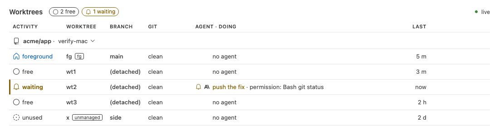
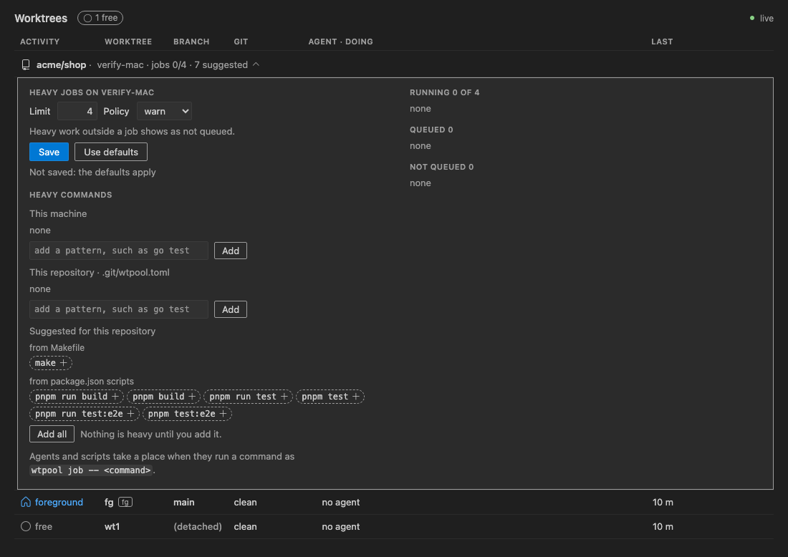

# The VS Code panel

[README](../README.md) · [Commands](commands.md) · [Configuration](configuration.md) ·
[Status and hook](status-and-hook.md) · **Panel** · [Heavy jobs](heavy-jobs.md) ·
[Development](development.md)

<picture>
  <source media="(prefers-color-scheme: dark)" srcset="images/panel-waiting-dark.png">
  
</picture>

Run **Worktrees: Open Status** from the Command Palette. A tab opens beside the active editor
group, or comes to the front. It runs `wtpool status --watch` while open; closing the tab stops it.
Each window has its own tab. The tab title reads `Worktrees (N)` while N worktrees wait.

To install it, see the [README](../README.md#the-extension). It needs the `wtpool` CLI. Agents
show only once the hooks are on: the plugin or the settings block, as the
[README](../README.md#the-hooks) says. Until then the tab names the two steps: `wtpool setup`, then
the hooks, through the plugin or the block `wtpool hook install` prints.

## Which pool it shows

The tab runs `wtpool` in the window's first workspace folder, both for the watch and for the row
actions, so it shows the pool of the repository that folder belongs to. It sets no `WTPOOL_FOREGROUND`
of its own; one in the environment VS Code started with still applies
([Configuration](configuration.md)). With no folder open, the tab says "Open a folder inside a git
repository to see its worktrees."

When `wtpool` exits with an error, for example because the folder is not inside a git repository,
the header shows its error message (the last non-empty line of its stderr) next to the paused
state, and retries. The message wraps; it is never cut off.

The extension runs on your local machine, and so does the `wtpool` it starts. In a Remote-SSH, WSL or
dev container window it shows the local pool, not the worktrees on the remote side.

## Header

Chips count `free`, `working` and `waiting` worktrees, and hide at 0. Click the waiting chip to
focus the first waiting row. The connection reads `live`, `updated N s ago` after 15 s without an
update, or `updates paused, retrying in N s` while the extension restarts `wtpool`.

## Rows

A heading row names the repository and the machine: `acme/app · my-mac`, with the GitHub
`owner/repo` when the remote is on github.com, else the main worktree's folder name. When the
document holds several pools, each gets its own heading. The machine name is a button that counts
heavy jobs and opens the machine strip: see [Heavy jobs](#heavy-jobs).

Under it, one row per worktree: foreground, then slots, then unmanaged, by name. Rows never move.

| Column | Shows |
|---|---|
| Activity | icon and word, see below |
| Worktree | name, plus ` fg` or ` unmanaged` |
| Branch | branch, or `(detached)` |
| Git | `clean`, else `N dirty`, `↑N`, `↓N`, `N unreferenced`, the operation, `unknown` |
| Agent · doing | one line per agent, newest first: `<label> · <what it does>` |
| Last | the age of each line |

The agent line reads `<tool> <target>` while working, `quiet · …` after 2 minutes without an event,
`<reason>: <tool> <target>` while waiting, `idle` or `API error: …`, and `done` for a finished
subagent, shown for 1 minute. A row without agents reads `build: <process>` or `no agent`. Under
the `warn` and `require` policies, a build that no job holds reads `build: make (not queued)`, on
an agent's line or the row's own, with ` (not queued)` in the attention colour.

Each agent line starts with a small icon of its state: the robot at rest while working, a clock
while quiet, a bell while waiting, a circle while idle, an error sign after an API error, and a
check mark when done. These icons never move. A `build:` or `no agent` line keeps an empty space
where the icon goes, so the text of every line starts at the same place. Screen readers read the
state in place of the icon, as `waiting: `.

A row with two or more agent lines shows `×N` after its Activity word, as in `working ×5`, in the
word's colour inside a thin border. `done` lines count, and `build:` and `no agent` lines do not.
Screen readers read it as `working, 5 agents`.

An agent whose turn ended still shows working while work it started runs:

- a session whose build still runs, such as a `cargo build` it started in the background, reads
  `build: <name>`, the outermost build, as in `build: cargo build`;
- a session or subagent with a background task still running reads `background: <summary>`, for
  the newest running task, as in `background: cargo test`. A subagent that ends its turn to wait
  for its own background run shows working, not `done`;
- a session or subagent whose `wtpool job` waits in the queue reads `queued: <label or summary>`,
  as in `queued: cargo test`. Once the job runs, the line shows the agent's own action, and a
  working agent stays working while the job runs. An agent that waits for you stays `waiting`.

Once the build ends, or the hook records the task's end, the agent shows its own state again.

Select a row to see the exact path, upstream, git facts, why `wtpool bg` refuses it, and per agent its
state, action, how it was placed (`cwd` or `path`) and since when (local time).

## Live output

When an agent runs a command in the background, such as a long `cargo build`, the selected row's
strip shows an Output section under that agent. For each task still running, and for the one that
ended last, it shows the command's summary (`cargo build`) with `running` or `ended HH:MM`, then
the last 15 lines of its output in a monospace block. New lines show within a second. The block
stays at its end as lines arrive; scroll it up to read, and it stays where you put it. Long lines
wrap. A tab shows as spaces, and any other control character as `\u{XXXX}`. A command the agent
runs in the foreground shows only in its agent line, as before.

**Follow** opens a VS Code terminal named after the agent and the task, such as
`session 20:31 · cargo build`. It shows the last 40 lines of the output, then each new line, with
its colours and with tabs as spaces. Closing the terminal stops it.

The output never passes through `wtpool`. The hook records only the path of the file Claude Code
writes the output to ([Status and hook](status-and-hook.md#background-tasks)), and the extension
reads that file on this machine, for the selected row only and only while the tab is visible. It
reads only paths the status document lists, and never a symlink or anything but a regular file.

## Activities

| Activity | Meaning |
|---|---|
| waiting | An agent waits for permission, an answer, a plan approval or MCP input. Highlighted. |
| working | An agent acted here within 2 minutes, its shell call builds here, a subagent it started works or waits, a build or background task it started still runs, or a heavy job of its own waits or runs. A robot swings its arms. |
| building | A build runs here without a working agent. A dial spins. |
| idle | A live session finished, went quiet, or hit an API error. |
| foreground | Your editor worktree, with no agent or build. |
| free | A detached, clean slot `wtpool bg` may reuse. |
| not reusable | A detached slot `wtpool bg` refuses. Select the row to see why. |
| unused | A slot that holds a branch, or an unmanaged worktree, with nothing running. |
| unknown | Git could not tell. Not safe. |
| missing | Its folder is gone. |

With VS Code's reduce motion on (`workbench.reduceMotion`, which follows the system by default),
the robot and the dial stand still.

## Row actions

Row actions appear on hover and keyboard focus:

- **Open in new window**, **Open terminal**, **Copy path**. A missing worktree offers only the copy.
- **Free this worktree…** runs `wtpool free <slot> --force`. **Bring its branch to the
  foreground…** runs `wtpool fg <branch> --force`. Both appear only on a slot that holds a branch.
  They pass `--force` because the tab judges the agents there itself, as the next paragraph says.

Free and fg always ask first, in a dialog that names the worktree and the branch. They refuse while
an agent in that slot works or waits, and warn when one is idle. They check the slot again after
you confirm, and run nothing if it changed. Errors from `wtpool` show as a notification. Nothing else
in the tab changes the pool.

## Heavy jobs

The machine name in the heading is a button. It counts this machine's heavy jobs and opens the
machine strip, where you set the limit, the policy and the heavy commands.
[Heavy jobs](heavy-jobs.md) explains them.



### The machine button

```
acme/app · my-mac · jobs 4/4 · 2 queued · 1 not queued
```

- `jobs R/L`: R jobs run, and L is the limit. It always shows.
- `· N queued`, in the attention colour, while N jobs wait.
- `· N not queued`, in the attention colour, while the policy is not `off` and N heavy processes
  run outside a job.
- `· N suggested`, muted, while this repository has N suggestions and no heavy commands of its
  own. It goes with the first pattern you add.
- A chevron at the end, which points up while the strip is open.

When `machine.toml` or the job folder cannot be read, the button reads `my-mac · jobs` with a
warning sign, in the problem colour, and the strip names the fault. With a `wtpool` that has no
`wtpool job`, the button holds only the machine name and the chevron, and the strip says:
`This wtpool has no heavy job limit. Update wtpool to a version with wtpool job to set one.`

Click the button, or press Enter or Space on it, to open or close the strip. Screen readers read
its counts in words, as `Heavy jobs on my-mac: 4 of 4 running, 2 queued, 1 not queued`.

### The machine strip

The strip opens under the heading, apart from a row's detail strip. On the left:

- `Heavy jobs on my-mac`;
- **Limit**, a field that holds the limit, and **Policy**, a menu of `off`, `warn` and `require`,
  then one line on what the chosen policy does;
- **Save** and **Use defaults**, then the answer to the last save: `Saved.`, or wtpool's error;
- `Saved in /Users/you/.config/wtpool/machine.toml · defaults 4, warn · 1 to 64`, or
  `Not saved: the defaults apply` while the file sets neither the limit nor the policy;
- **Heavy commands**, the pattern editor, below;
- `Agents and scripts take a place when they run a command as wtpool job -- <command>.`

On the right, three lists: `Running R of L`, `Queued N` and, unless the policy is `off`,
`Not queued N`, in the attention colour. Each line holds the job's place in line (Queued only), its
label or summary, its worktree and agent, or `outside this pool`, and its age. An empty list reads
`none`.

Save runs `wtpool job limit <N>`, then `wtpool job enforce <policy>`, each only when you changed
it. **Use defaults** runs `wtpool job limit default` and `wtpool job enforce default`. The tab
runs them one at a time, with an argument array and no shell, and stops one after 10 s, as in
`wtpool job limit timed out`. Nothing runs after a call that failed. The tab writes no file
itself: the next document, within a second, shows the new settings.

- The Limit field checks as you type. Anything but a whole number from 1 to 64 marks it invalid,
  shows `Enter a whole number from 1 to 64.` under it, and Save then sends nothing.
- When wtpool refuses, as for a `machine.toml` that is a symlink, the strip shows its message, and
  your value stays in the field.
- While more jobs run than a lowered limit, the strip says, for example:
  `4 running, over the limit of 2: they finish, and queued jobs start once fewer than 2 run.`
- In a Remote-SSH, WSL or dev container window, `wtpool` runs on your computer, so the settings
  are your computer's. The strip adds:
  `This window's folder is not on this computer: the settings are for this computer, my-mac.`

The strip follows each document in place, and keeps what you typed but did not save.

### The pattern editor

**Heavy commands** holds two lists:

- **This machine**: the patterns in `machine.toml`, used in every repository;
- **This repository · .git/wtpool.toml**: this repository's patterns, with its `build_processes`
  names tagged `build_processes`.

Each pattern is a chip, in monospace, with a remove button. An empty list reads `none`. After each
list come a field, `add a pattern, such as go test`, and **Add**. The field checks the pattern
first, and says why under it, sending nothing: `Already in this list.`, or for text that is not a
pattern:

```
Not a pattern: 1 to 3 words of letters, digits and . _ + -, and : after the first, none starting with - or +; only the first may end in *.
```

A refusal from wtpool shows there too.

While this repository has suggestions, **Suggested for this repository** follows, grouped by the
file they came from, as `from Cargo.toml` or `from package.json scripts`. Each suggestion is a chip
with a dashed border and an add button. **Add all** adds every one shown, next to the note
`Nothing is heavy until you add it.`

Each remove, add and **Add all** runs one `wtpool job heavy` call at once, such as
`wtpool job heavy add --repo -- make` or `wtpool job heavy rm -- just`. **Add all** runs
`wtpool job heavy add --repo --` with every suggestion shown. The chips change with the next
document. Suggestions show as plain text, so a file in a repository cannot add a link or markup to
the tab.

### Keyboard

- Tab reaches the machine button. Enter or Space opens the strip and moves focus to the Limit
  field. Escape anywhere in the strip, except in the open Policy menu, closes it and returns focus
  to the button.
- Enter in the Limit field or the Policy menu saves, as Save does.
- Tab goes from the field to the menu, Save, Use defaults, the pattern editor, then the rows.
- Each list of chips, the suggestions included, is one tab stop, labelled for screen readers as
  `Heavy commands of this machine, 2`. Focus enters on the chip you focused last, else the first.
  The arrow keys move between chips, and Home and End go to the first and the last.
- In **This machine** and **This repository**, Delete, Backspace, Enter or Space removes the focused
  chip's pattern. Among the suggestions, Enter or Space adds it. Focus then moves to the next chip,
  else the previous one, else the list's field or **Add all**.
- Tab goes on from a list to its field and **Add**, or to **Add all**. Enter in a field adds, as
  Add does.
- Screen readers hear each answer once it comes: `Saved.`, `Added make.`, `Removed protoc.`,
  `Added 6 suggestions.`, or the error.

## Settings

| Setting | Default | Meaning |
|---|---|---|
| `wtpool.path` | `wtpool` | The `wtpool` binary the tab runs. Only user settings can set it. It runs with an argument array and no shell. |
